# DataMask4j — Java Data Masking & GDPR Pseudonymisation

**Open-source Java data masking library for privacy-first test data management, GDPR-oriented pseudonymisation and sensitive data protection.**

DataMask4j masks Java records represented as string maps locally, with explicit field policies and deterministic HMAC-SHA-256 tokens. It is designed for Java teams building safer development, QA and staging datasets. CSV and flat JSON adapters and restricted YAML policy loading are present in the development snapshot. PostgreSQL read-only preview and an experimental ordered transactional export are available in the development snapshot. European locale-aware synthetic names and test-domain email substitution are implemented; annotation-driven masking of public flat Java records is in development. An opt-in Spring Boot starter is implemented; Spring Batch 6 item processors are in development. Automatic relational planning and XML are planned.

[](LICENSE)

[](https://openjdk.org/projects/jdk/21/)
[](https://github.com/hamzador/DataMask4j/actions/workflows/ci.yml)

> Early development (0.1.0-SNAPSHOT). Nothing has been published to Maven Central. The current snapshot includes local masking, restricted PostgreSQL export, locale-aware fixtures, annotations and an opt-in Spring Boot starter. It is not production-certified. Spring Batch processors are experimental; XML and automated anonymization are not available.

## Why DataMask4j?

Development, QA, staging, demonstrations and incident reproduction often need realistic data. Copying production datasets directly into these environments can expose personal information, trade secrets and financial data. Ad-hoc replacements may break equality relationships, silently leave sensitive columns untouched or generate identifiers that are unsafe to use.

DataMask4j aims to make transformations explicit, repeatable, testable and auditable while leaving data ownership and access decisions with the application.

Typical use cases:

- Create masked customer fixtures for a Java integration test.
- Replace direct identifiers with stable, scoped pseudonyms for a controlled test dataset.
- Remove fields that are unnecessary for testing, rather than copying everything.
- Apply the same reviewed field policy in multiple applications.
- Eventually export a consistent, masked relational subset into an isolated test environment.

### European privacy context

The project is motivated by data minimisation and privacy by design, particularly GDPR Articles 5, 25 and 32. Pseudonymisation is defined in Article 4(5); pseudonymised personal data can still be personal data. Masking names or identifiers alone does not establish anonymisation. Indirect identifiers, correlations, small groups and external information may enable reidentification.

DataMask4j is a technical building block, **not a GDPR certification, legal opinion or guarantee of anonymity**. Organisations remain responsible for lawful processing, access controls, retention, risk analysis, data subject rights and any necessary DPIA.

References: [GDPR official text](https://eur-lex.europa.eu/eli/reg/2016/679/oj), [CNIL anonymisation guidance](https://www.cnil.fr/fr/lanonymisation-de-donnees-personnelles).

## How DataMask4j works

The diagrams below show local masking, restricted database exports and deterministic European test fixtures. GitHub renders Mermaid directly; the surrounding text also explains the architecture for search engines and readers without diagram support.

### PostgreSQL data masking dry run (development snapshot)

The optional `datamask4j-jdbc` module validates and masks rows in memory without returning records or writing to a target. The only result is a counts-only report. Use a dedicated SELECT-only PostgreSQL role and a separately configured datasource. The implementation checks the actual database name, PostgreSQL read-only transaction state and write privileges on the selected table. It accepts an ordinary table with text/varchar columns and strict lowercase identifiers. Views, RLS tables, partitions and unsupported column types are rejected.

```xml
<dependency>
    <groupId>io.github.hador</groupId>
    <artifactId>datamask4j-jdbc</artifactId>
    <version>0.1.0-SNAPSHOT</version>
</dependency>
```

```java
import io.github.hador.datamask4j.core.*;
import io.github.hador.datamask4j.jdbc.*;

var policy = MaskingPolicy.builder()
    .field("id", FieldRule.keep())
    .field("email", FieldRule.redact())
    .field("notes", FieldRule.drop())
    .build();

var report = new JdbcMasker(new DataMasker(policy)).dryRun(
    sourceDataSource,
    new JdbcTable("customer_db", "public", "customer")
);
// report.rowsProcessed(), report.sourceColumns(), report.outputColumns()
```

The source datasource is supplied by your application; the PostgreSQL driver is not a runtime dependency of this module. The preview requires a fresh auto-commit connection, switches to a read-only transaction and rolls back on exit. The connection is owned and closed by the module. Default bounds are 100,000 rows, 128 columns, 65,536 UTF-16 code units per value, fetch size 100 and query timeout 30 seconds. These are not a server memory or wall-clock guarantee. Use trustworthy providers and separately enforced database permissions, network restrictions and connection timeouts. Custom strategies must not create side effects. Use the separate experimental JdbcExporter for restricted single-table export; dryRun itself never writes.

## Architecture: small core, optional adapters

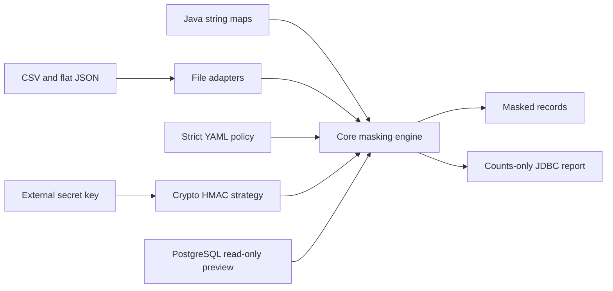

### Field policy: fail closed

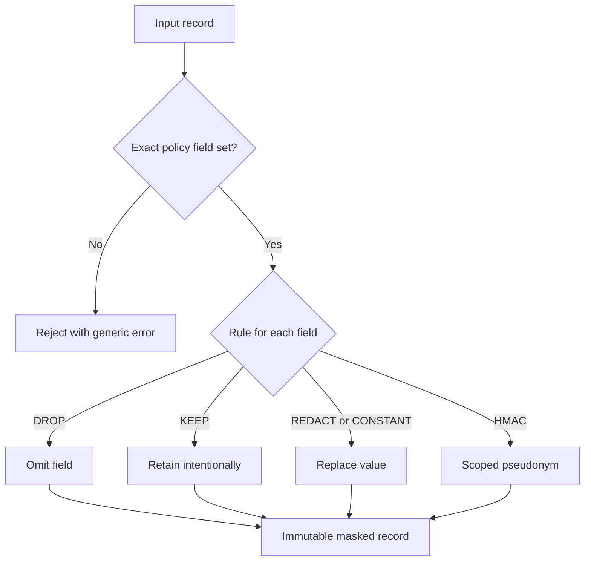

### Deterministic identity across datasets

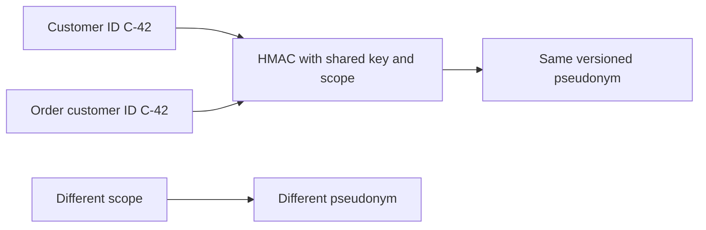

Equality preservation is useful for joins but is not a guarantee of anonymity or referential integrity. Keep keys separate from masked datasets.

### Streaming file masking

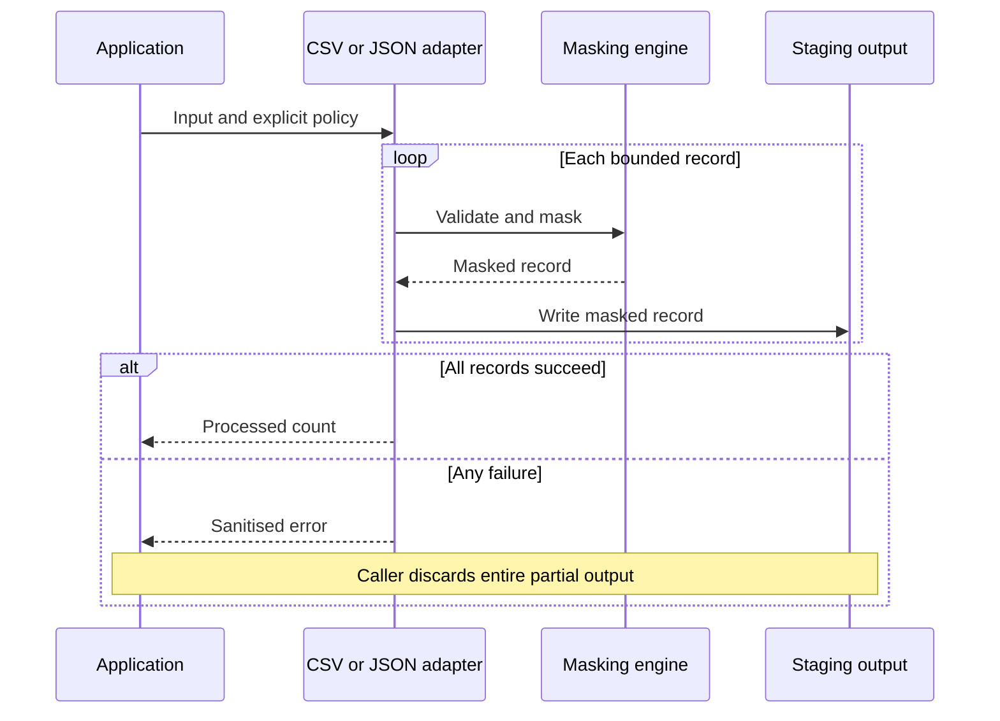

### Database trust boundary (preview and experimental export)

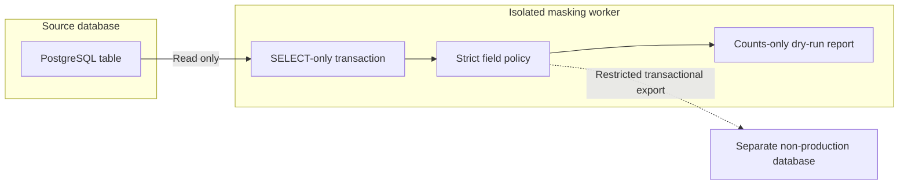

JdbcMasker performs a read-only dry run. JdbcExporter separately supports INSERT-only transactions into an empty test table. Restricted ordered multi-table export is experimental; automatic planning remains a later milestone.

## Design principles

- Local execution: no telemetry, remote masking service or network access in the core.
- Explicit policy: all input fields must have a rule; unknown and missing fields fail closed.
- Minimise first: drop a field when it is unnecessary; keep a field only after intentional classification.
- Determinism when needed: keyed HMAC-SHA-256 with explicit scopes and versioned tokens.
- No mutation of the input map. Returned maps are immutable and may contain null.
- No sensitive values in library-generated errors, no implicit logging, no embedded secret.
- Small, dependency-free runtime; Java 21 baseline.
- No claim that cryptographic transformation alone preserves uniqueness, legal anonymity or referential integrity.

## Current capabilities

| Feature | Status |
| --- | --- |
| String-valued records represented as maps | Initial milestone |
| Explicit allowlist policy and schema checking | Initial milestone |
| Keep, drop, constant replacement, redaction | Initial milestone |
| HMAC-SHA-256 pseudonymisation, domain separation | Initial milestone |
| Immutable output, null preservation | Initial milestone |
| CSV and flat JSON adapters | Implemented (snapshot; initial CI passed) |
| XML adapter | Planned |
| Explicit public flat Java record annotations | CI passed (80 reactor tests) |
| Nested records / Java beans | Planned |
| Restricted YAML policy loading | Implemented (snapshot; initial CI passed) |
| PostgreSQL JDBC read-only dry run | Unit and real PostgreSQL CI passed (50 reactor tests) |
| Single-table transactional PostgreSQL export | Initial CI passed (57 tests total) |
| Ordered multi-table export with restricted target foreign keys | Initial CI passed (63 tests total) |
| Spring Boot opt-in RecordMasker starter | CI passed (91 reactor tests) |
| Spring Batch 6 explicit item processors | CI passed (99 total tests) |
| Spring Batch JDBC chunk rollback and restart fixture | CI passed (101 total tests) |
| Offline CSV/JSON CLI with safe publication | CI passed (110 total tests and runnable JAR smoke test) |
| European synthetic names and test-domain email (Java API) | Initial CI passed (71 tests total) |
| Expanded faker formats and key rotation | Planned |

Detailed roadmap below. Only use features that exist in the current source tree.

## Documentation website and parallel CI

A static, English documentation website is prepared under [docs/](docs/), with five topic-focused pages, unique titles and descriptions, canonical URLs, a sitemap and no third-party scripts. To publish it, the maintainer must enable GitHub Pages from the repository's main branch, /docs folder. Intended address: `https://hamzador.github.io/DataMask4j/` (publication not verified). Do not assume indexing or ranking.

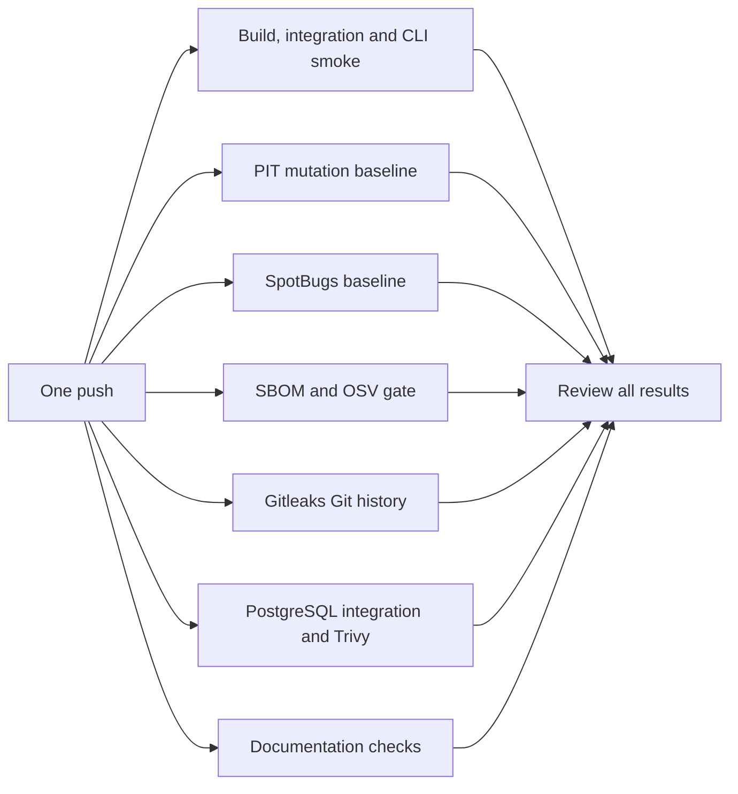

Independent jobs run on separate runners. The prior CI passed all seven jobs (110 distinct Java tests, 73 Maven coordinates with no OSV matches, zero HIGH/CRITICAL findings in the patched PostgreSQL image). New gates enforce measured per-module line-coverage floors (91% core, 94% crypto, 35% JDBC unit and 100% PostgreSQL integration, 94–100% other modules), mutation floors of 82% core and 68% crypto, and zero SpotBugs findings. The exact unrounded measured ratios are used. These are non-regression floors, not proof of correctness. Some crypto cleanup mutants remain unobservable through the public API; no exclusions are added. New gate validation is pending. Each Maven-running job also inventories its isolated local resolved JAR coordinates and runs a report-only OSV scan of build and plugin dependencies. Unlike the project SBOM gate, build inventory findings still need remediation/review before release; missing or failed inventories fail CI. OSV, Gitleaks and HIGH/CRITICAL PostgreSQL image findings fail their jobs. The SBOM includes project dependencies and PostgreSQL profile test dependencies, not a complete build-plugin inventory. The PostgreSQL integration and Trivy checks share a dedicated runner. A CI-only derivative of the pinned upstream image replaces gosu with a build from locked upstream source using checksum-pinned Go 1.27.4. Tests assert the actual container image ID; Trivy scans the same local image with unchanged HIGH/CRITICAL blocking. Initial scan found 26 findings in gosu; the patched image scanned clean (zero HIGH/CRITICAL findings) and passed all 23 PostgreSQL integration tests in run 44204487332. Local integration runs without CI preparation still use the original pinned base; its known findings mean it should only be used for isolated synthetic testing until repaired. Testcontainers helper images remain outside this scan. The unit build repeats some tests in the JDBC job; count distinct tests, not the sum of job totals. All seven jobs and the build inventory findings must be reviewed; neither a green scanner nor a green build proves production safety.

## Requirements and build

- JDK 21 or newer
- Maven 3.9+
- Git

```bash
git clone https://github.com/hamzador/DataMask4j.git
cd DataMask4j
mvn -B -ntp clean verify
mvn -B -ntp clean install
```

The second command installs development artifacts into your local Maven repository only. No remote publishing is configured. The planned Maven group ID is `io.github.hador`; namespace ownership must be verified in the Central Portal before publishing. The GitHub repository remains `hamzador/DataMask4j`.

### Maven coordinates (local development only)

```xml
<dependency>
    <groupId>io.github.hador</groupId>
    <artifactId>datamask4j-core</artifactId>
    <version>0.1.0-SNAPSHOT</version>
</dependency>
<dependency>
    <groupId>io.github.hador</groupId>
    <artifactId>datamask4j-crypto</artifactId>
    <version>0.1.0-SNAPSHOT</version>
</dependency>
```

The crypto module depends on core. Use only core if you do not need HMAC. These coordinates resolve locally after installation; there is no public release yet.

## Quick start

```java
import io.github.hador.datamask4j.core.*;
import java.util.Map;

var policy = MaskingPolicy.builder()
    .field("customerId", FieldRule.keep())
    .field("name", FieldRule.redact())
    .field("email", FieldRule.constant("masked@example.test"))
    .field("phone", FieldRule.drop())
    .build();

var input = Map.of(
    "customerId", "C-1001",
    "name", "Example Customer",
    "email", "private@example.test",
    "phone", "0000000000"
);

Map<String, String> masked = new DataMasker(policy).mask(input);
```

Expected output (ordering is not part of the API):

```json
{
  "customerId": "C-1001",
  "name": "[REDACTED]",
  "email": "masked@example.test"
}
```

The phone field is absent, the source map is unchanged, and the ID is deliberately retained only for illustration. A real customer ID may itself identify someone: classify it and prefer a scoped pseudonym where appropriate. A constant email is not unique and is unsuitable for a unique column.

## Stable pseudonymisation and scoped identity

Use a randomly generated key of at least 32 bytes, supplied by an approved secret manager. Never commit the key, log it or send it with the output dataset. The following example reads a Base64-encoded key from the environment; environment variables are a local example, not a full key management solution.

```java
import io.github.hador.datamask4j.core.*;
import io.github.hador.datamask4j.crypto.HmacPseudonymizer;
import java.util.Arrays;
import java.util.Base64;
import java.util.Map;
import java.util.Objects;

byte[] key = Base64.getDecoder().decode(
    Objects.requireNonNull(System.getenv("DATAMASK_KEY_BASE64"))
);
try {
    var identity = new HmacPseudonymizer(key, "customer-id:v1");
    var email = new HmacPseudonymizer(key, "customer-email:v1");
    var customers = new DataMasker(MaskingPolicy.builder()
        .field("id", FieldRule.transform(identity))
        .field("email", FieldRule.transform(email))
        .build());
    var orders = new DataMasker(MaskingPolicy.builder()
        .field("customerId", FieldRule.transform(identity))
        .field("orderId", FieldRule.keep())
        .build());

    var customer = customers.mask(Map.of("id", "C-42", "email", "demo@example.test"));
    var order = orders.mask(Map.of("customerId", "C-42", "orderId", "O-1"));
    assert customer.get("id").equals(order.get("customerId"));
} finally {
    Arrays.fill(key, (byte) 0);
}
```

Generate a key with an approved cryptographically secure generator. For local Unix development only: `openssl rand -base64 32` (avoid shell history and insecure storage; do not reuse a test key in production).

Properties of the default token:

- HMAC-SHA-256 over a fixed protocol label and length-prefixed UTF-8 scope and input.
- Output: `dm1_` followed by 43 unpadded Base64URL characters (47 characters total).
- Exact input bytes matter: there is no trimming, case folding, Unicode normalisation or type conversion. Malformed UTF-16 is rejected rather than silently replaced.
- Same key, scope and value produce the same result. Changing the key or scope intentionally breaks linkage.
- Identical source IDs and the same scope can preserve equality across separately transformed records; this is not yet a relational integrity engine. Check target lengths, collation, uniqueness, foreign keys and canonicalisation.
- Stable tokens can reveal frequency and equality. A compromised key or accessible tokenisation oracle may enable guessing, especially for low-entropy identifiers. Isolate keys and scopes by purpose, tenant and environment.
- HMAC is not encryption; there is no decryption API. Key rotation requires deliberate migration or regeneration.
- The caller can clear its input key bytes; Java/JCA may retain internal copies, so this is not a guarantee of memory erasure.

### Nulls, empty strings and strict input policies

```java
import java.util.HashMap;
import java.util.Map;
import io.github.hador.datamask4j.core.*;

var masker = new DataMasker(MaskingPolicy.builder()
    .field("email", FieldRule.redact())
    .field("internalNotes", FieldRule.drop())
    .build());

Map<String, String> nullable = new HashMap<>();
nullable.put("email", null);
nullable.put("internalNotes", "not needed");
var result = masker.mask(nullable); // email is present with null; notes absent

// Unknown or missing fields are errors, even if their values are null.
masker.mask(Map.of("email", "demo@example.test")); // throws MaskingException
```

Null is preserved for non-drop rules; empty strings are real values. Duplicate rules, blank field names and null arguments are rejected. No wildcard or implicit KEEP behaviour exists. A policy containing only DROP rules may return an empty map.

### Custom strategies

```java
var policy = MaskingPolicy.builder()
    .field("country", FieldRule.keep())
    .field("postalCode", FieldRule.transform(value ->
        value.length() >= 2 ? value.substring(0, 2) + "***" : "[REDACTED]"))
    .build();
```

Custom strategies must be trusted, deterministic if required, thread-safe for concurrent use, and must never log raw inputs. The engine rejects null transformation results for non-null inputs and wraps ordinary strategy failures without exposing causes or values. It cannot prevent custom code from logging, accessing external services or retaining secrets. Generalisation alone does not establish anonymity.

## Mask CSV, JSON and YAML-defined policies (development snapshot)

The optional `datamask4j-file` module adds streaming CSV and JSON transformations using the same strict engine. CSV is comma-separated with a required header. JSON accepts one array of flat objects with string or null values. Numbers, booleans, arrays and nested objects are rejected rather than coerced. YAML is a restricted **policy** format, not a YAML dataset masker.

```xml
<dependency>
    <groupId>io.github.hador</groupId>
    <artifactId>datamask4j-file</artifactId>
    <version>0.1.0-SNAPSHOT</version>
</dependency>
```

Create `masking.yml` (synthetic example):

```yaml
fields:
  id:
    strategy: hmac
    scope: customer-id:v1
  email:
    strategy: constant
    value: 'masked@example.test'
  notes:
    strategy: drop
```

Only keep, drop, redact, constant (value required) and hmac (scope required, external key) are accepted. All other options are rejected. Quote YAML strings that could otherwise be parsed as booleans, dates or numbers. Duplicate keys, anchors, aliases, merges, custom tags and multi-document policies are rejected. Do not store credentials or keys in YAML.

```java
import io.github.hador.datamask4j.core.DataMasker;
import io.github.hador.datamask4j.file.*;
import java.io.StringReader;
import java.io.StringWriter;
import java.nio.file.Files;
import java.nio.file.Path;
import java.util.Base64;
import java.util.Objects;

byte[] key = Base64.getDecoder().decode(
    Objects.requireNonNull(System.getenv("DATAMASK_KEY_BASE64")));
try (var policySource = Files.newBufferedReader(Path.of("masking.yml"))) {
    var masker = new DataMasker(new YamlPolicyLoader().load(policySource, key));
    var csv = new StringWriter();
    long count = new CsvMasker(masker).mask(
        new StringReader("id,email,notes\nC-1,private@example.test,unneeded\n"), csv);
    // Output header is id,email; count is 1. ID becomes a scoped token.
    var json = new StringWriter();
    new JsonMasker(masker).mask(new StringReader("""
        [{"id":"C-1","email":"private@example.test","notes":"unneeded"}]
        """), json);
    // JSON output contains the same pseudonym, masked email, and no notes.
} finally {
    java.util.Arrays.fill(key, (byte) 0);
}
```

### File safety and limits

Defaults: 8,388,608 UTF-16 code units each for input and output; 100,000 records; 128 fields; 65,536 code units per field name/value. Adjust with `new FileMaskingLimits(inputChars, outputChars, records, fields, valueChars)` when appropriate. Parser allocation may occur before per-field checks; these limits are not a JVM memory sandbox. YAML has independent fixed caps: 262,144 input code units, 128 fields, nesting depth 8, 65,536 code units per scalar.

CSV validates the full header even for empty datasets, prohibits duplicate columns and mismatched row widths, rejects exports that drop every column, and rejects common spreadsheet formula prefixes in retained header/cells (including legitimate negative numbers). This is a conservative protection, not universal spreadsheet safety; use a non-executable format or import as text if necessary. CSV input uses strings (empty string is not null), and cannot preserve a distinction between null and empty output. JSON preserves nulls and rejects duplicate keys and trailing documents. Both adapters leave caller streams open and return a count only on success. Supply distinct input/output streams.

**Streaming is not transactional.** On any exception, discard the entire output, even if some records were already written. For files, use a new restricted-permission staging destination and publish only after successful masking and verification. Never write over the source or use a production destination. No atomic file move or database protection is implemented yet.

## Transactional PostgreSQL test-data export (experimental snapshot)

The JDBC exporter supports single-table export and ordered multi-table plans. It never creates, updates, deletes, truncates or overwrites tables. A SELECT-only source and a distinct, empty target table must be provisioned by the operator. Target database names must start with `dm_test_`; this naming convention is a guard, **not proof that the database is safe or non-production**. The actual database name and expected non-privileged writer role are verified. Use a separate isolated cluster/network in real deployments.

```java
var policy = MaskingPolicy.builder()
    .field("email", FieldRule.redact())
    .field("notes", FieldRule.drop())
    .build();

var exporter = new JdbcExporter(new DataMasker(policy));
var report = exporter.export(
    sourceDataSource,
    new JdbcTable("customer_db", "public", "customer"),
    testDataSource,
    new JdbcExportTarget(
        new JdbcTable("dm_test_customers", "public", "customer_masked"),
        "dm_mask_writer"
    )
);
```

Example target provisioning, to be executed by an authorised administrator **on the isolated test instance only** (credentials supplied by a secret manager):

```sql
CREATE TABLE public.customer_masked (email text);
GRANT USAGE ON SCHEMA public TO dm_mask_writer;
GRANT SELECT, INSERT ON public.customer_masked TO dm_mask_writer;
```

The writer role must already exist, must not own the table, and must not have UPDATE, DELETE, TRUNCATE, TRIGGER or REFERENCES on it. The source role remains SELECT-only. The destination must have exactly the retained text/varchar columns, with no generated fields, defaults, triggers, rules, inheritance, RLS, expression/partial indexes or unsupported constraints. PK, UNIQUE and NOT NULL constraints are enforced by PostgreSQL. Single-table export rejects foreign keys outside its plan. The ordered multi-table API supports a restricted subset of foreign keys. Automatic relational planning is not supported.

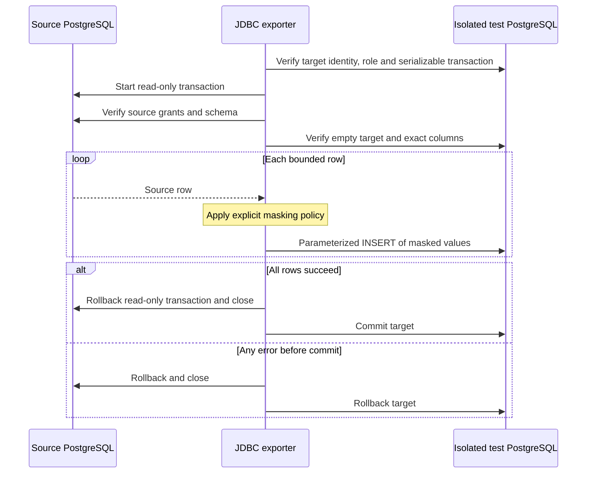

The target transaction uses SERIALIZABLE isolation, and no automatic retry is performed. A connection failure around commit can leave the outcome unknown: inspect the target before retrying. This initial API assumes trusted database administration, stable schemas and no concurrent privileged DDL or external writes; it does not sandbox custom strategies, database extensions or administrative functions. Use isolated disposable targets, a reviewed policy, least privilege, and do not send output to a test system that is allowed to access production or its keys. No raw values are included in library-generated errors or reports.

## Relational database masking: ordered multi-table export (experimental)

Use `JdbcExporter.exportAll` to export up to 32 explicitly listed tables in a single target transaction. Each step has its own complete field policy. All source tables must use the same source database; all targets must share the same dedicated test database and expected writer role. A repeatable-read source transaction provides a consistent snapshot; the row limit applies to the entire plan. Reports follow plan order and are returned only after target commit.

```java
var sharedIdentity = new HmacPseudonymizer(secretKey, "customer-id:v1");
var customers = new DataMasker(MaskingPolicy.builder()
    .field("id", FieldRule.transform(sharedIdentity))
    .field("name", FieldRule.redact())
    .build());
var orders = new DataMasker(MaskingPolicy.builder()
    .field("id", FieldRule.keep())
    .field("customer_id", FieldRule.transform(sharedIdentity))
    .build());

var plan = List.of(
    new JdbcExportStep(
        new JdbcTable("customer_db", "public", "customer"),
        new JdbcExportTarget(
            new JdbcTable("dm_test_customers", "public", "customer"),
            "dm_mask_writer"), customers),
    new JdbcExportStep(
        new JdbcTable("customer_db", "public", "orders"),
        new JdbcExportTarget(
            new JdbcTable("dm_test_customers", "public", "orders"),
            "dm_mask_writer"), orders)
);
var reports = JdbcExporter.exportAll(sourceDataSource, testDataSource,
    plan, JdbcMaskingLimits.defaults());
```

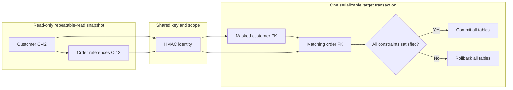

The caller supplies parent-before-child order and matching policies. Target foreign keys must be validated, immediate NO ACTION/RESTRICT constraints wholly inside the plan. External references, cycles, self-references, deferred or cascading constraints and non-FK triggers are rejected. PostgreSQL enforces target PK/UNIQUE/FK/NOT NULL constraints. The exporter does not infer source relationships, prove semantic equivalence of keys or automatically choose policies. A wrong scope can cause a target FK violation and rollback; constraints alone cannot detect a wrong-but-consistent mapping. Use identical canonicalisation, keys and scopes. No database-wide discovery, subset selection or cyclic schema support.

## European synthetic test data (Faker module)

The optional `datamask4j-faker` module provides deterministic, locale-aware field substitutions using the existing HMAC engine. It adds no third-party runtime dependency. Seven curated language/region variants are provided: fr-FR, de-DE, es-ES, it-IT, fr-BE, nl-BE, nl-NL. Each uses a small fixed vocabulary of eight first names and eight surnames, not an exhaustive or statistically representative name generator.

```xml
<dependency>
    <groupId>io.github.hador</groupId>
    <artifactId>datamask4j-faker</artifactId>
    <version>0.1.0-SNAPSHOT</version>
</dependency>
```

```java
import io.github.hador.datamask4j.core.*;
import io.github.hador.datamask4j.faker.*;
import java.util.Map;

// Load a random key of at least 32 bytes from your approved secret manager.
var faker = new EuropeanFaker(secretKey, "qa-customers:v1", EuropeanLocale.FR_FR);
var masker = new DataMasker(MaskingPolicy.builder()
    .field("displayName", FieldRule.transform(faker.fullName()))
    .field("email", FieldRule.transform(faker.email()))
    .field("phone", FieldRule.drop())
    .build());
var result = masker.mask(Map.of(
    "displayName", "Synthetic input",
    "email", "private@example.test",
    "phone", "not needed"
));
```

The name is selected from the locale vocabulary; email uses a 64-character lowercase hexadecimal HMAC digest followed by `@example.test` (77 characters in total). No original substring or input-controlled domain is copied. The fixed .test top-level domain is reserved for testing ([RFC 2606](https://www.rfc-editor.org/rfc/rfc2606)); disable outbound email in all test environments anyway. No unique-name guarantee: collisions are intentional and expected. Names may coincide with real people.

### Consistent identity fixtures

```java
String seed = "C-42"; // Opaque synthetic identity seed
String first = faker.firstName().transform(seed);
String last = faker.lastName().transform(seed);
String full = faker.fullName().transform(seed);
assert full.equals(first + " " + last);
```

Name components agree only when the same seed, key, scope, locale and module version are used. Masking separate fields with different original inputs cannot guarantee cross-field agreement; applications must deliberately supply a common identity seed where needed. Email tokens are separated from name selection by purpose and locale. Reserve the `faker:v1:` scope prefix for this module. Key/scope/locale changes can change generated values. Name vocabularies may change in future explicitly versioned algorithms.

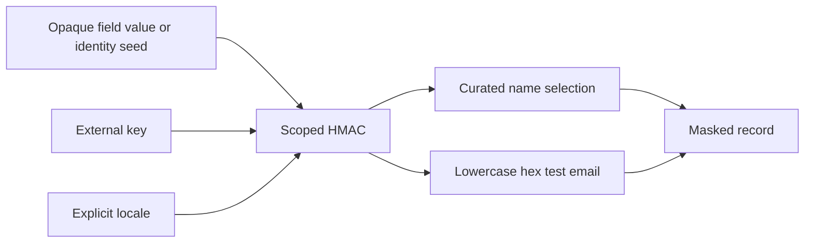

These are pseudonymising substitutions, not independently generated anonymous datasets. Equality/frequency and auxiliary attributes can still leak information. No valid phone numbers, deliverable addresses, national identifiers or bank details are generated in this milestone, avoiding accidental use of real contact or financial details. YAML integration of these strategies is not yet supported; use the Java API. Richer vocabularies, realistic locale formats and separately reviewed fixture providers are future work.

## Annotation-driven Java record masking

The optional `datamask4j-annotations` module provides explicit, immutable-copy masking for public flat Java records. Every record component must carry a `@Mask` annotation, even intentionally retained IDs. The library validates the complete record shape before invoking any accessor; it never implicitly retains an unclassified component.

```xml
<dependency>
    <groupId>io.github.hador</groupId>
    <artifactId>datamask4j-annotations</artifactId>
    <version>0.1.0-SNAPSHOT</version>
</dependency>
```

```java
import io.github.hador.datamask4j.annotations.*;
import io.github.hador.datamask4j.faker.EuropeanLocale;
import static io.github.hador.datamask4j.annotations.MaskType.*;

public record Customer(
    @Mask(strategy = KEEP) long internalId,
    @Mask(strategy = HMAC, scope = "customer-id:v1") String customerId,
    @Mask(strategy = FAKE_NAME, scope = "customer-name:v1",
          locale = EuropeanLocale.FR_FR) String fullName,
    @Mask(strategy = FAKE_EMAIL, scope = "customer-email:v1") String email,
    @Mask(strategy = REDACT) String notes,
    @Mask(strategy = NULLIFY) String phone
) {}
```

```java
// Load a random key of at least 32 bytes from an approved secret manager.
var masker = new RecordMasker(secretKey);
var original = new Customer(42L, "C-42", "Example Name",
    "private@example.test", "private notes", "not needed");

Customer masked = masker.mask(original);
// original remains unchanged; masked is a new Customer instance.
```

| Strategy | Effect |
| --- | --- |
| KEEP | Explicitly retain a String or primitive/boxed scalar |
| REDACT | Replace a non-null String with [REDACTED] |
| CONSTANT | Replace a non-null String with the configured value |
| NULLIFY | Replace a String with null |
| HMAC | Full scoped HMAC token; external key and scope required |
| FAKE_FIRST_NAME / FAKE_LAST_NAME / FAKE_NAME | Select a locale-aware synthetic name from the keyed input |
| FAKE_EMAIL | Generate a deterministic email in example.test |

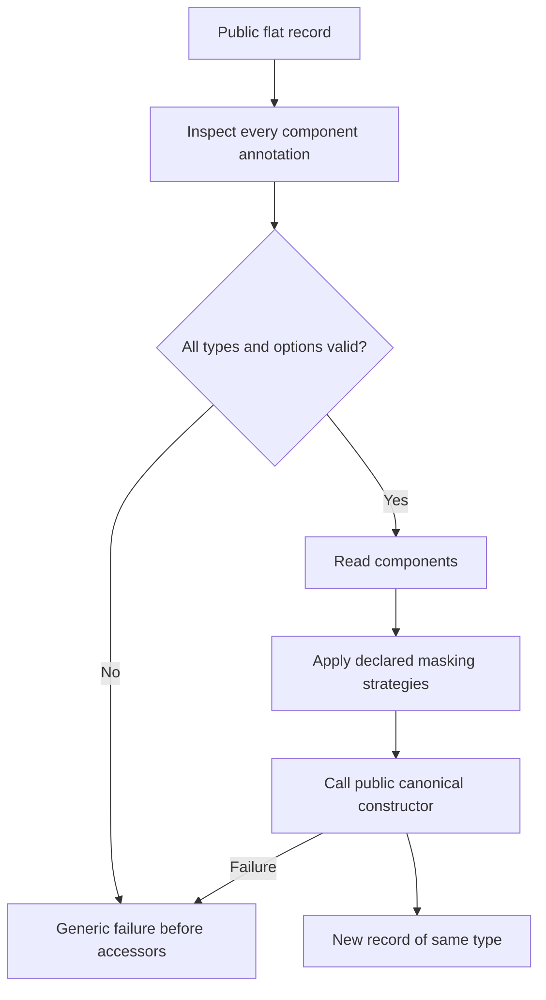

A record has a fixed shape, so DROP is deliberately unavailable: use NULLIFY for a nullable String or construct a separate data-transfer type if a field must be absent. Null input components remain null, even under CONSTANT. Non-String types are only supported for explicitly retained immutable scalar values; nested records, collections, arrays, POJOs, private records and automatic traversal are not supported. Up to 128 components are allowed. No accessibility override, runtime code generation or external framework is used.

For unkeyed policies use `new RecordMasker()`. Keyed strategies require an externally supplied key and explicit nonblank scope; the faker scope prefix is reserved. Keep keys and sensitive values out of annotation literals. The default faker locale is fr-FR; nondefault locales are only allowed with faker strategies. Name components generated from separate inputs are not automatically coherent. Record accessors and canonical constructors are trusted application code: they must not log, mutate, perform I/O or undo transformations. Constructors may reject nulls or transformed values; failures are sanitized, and no result is returned. This API cannot undo application-side effects or guarantee anonymity.

## Spring Boot data masking starter (development snapshot)

Use the optional starter to inject an explicitly enabled `RecordMasker` into a Spring Boot application. The initial baseline is Java 21 and Spring Boot 4.0.9. Other Spring Boot versions, native images and reactive/servlet integrations are not yet validated.

```xml
<dependency>
    <groupId>io.github.hador</groupId>
    <artifactId>datamask4j-spring-boot-starter</artifactId>
    <version>0.1.0-SNAPSHOT</version>
</dependency>
```

```yaml
datamask4j:
  enabled: true
  key-required: true
```

The starter is disabled by default. When enabled, a key provider is required unless `key-required: false` is explicitly selected. The starter does not receive a key through Spring configuration properties. Provide a secret-manager integration as an application bean. The returned key must be a fresh array that the starter owns and clears after copying; never return a shared backing array. Use a random key of at least 32 bytes.

```java
import io.github.hador.datamask4j.spring.MaskingKeyProvider;
import org.springframework.context.annotation.Bean;
import org.springframework.context.annotation.Configuration;

@Configuration(proxyBeanMethods = false)
public class MaskingConfiguration {
    @Bean
    MaskingKeyProvider maskingKeyProvider(ApprovedSecretStore secrets) {
        // ApprovedSecretStore is your application-specific secret-manager adapter.
        // readFreshKey must transfer an independent byte array to the starter.
        return () -> secrets.readFreshKey("qa/customer-pseudonymisation");
    }
}
```

```java
import io.github.hador.datamask4j.annotations.RecordMasker;
import org.springframework.stereotype.Service;

@Service
public class CustomerMaskingService {
    private final RecordMasker masker;

    public CustomerMaskingService(RecordMasker masker) {
        this.masker = masker;
    }

    public Customer maskForTest(Customer source) {
        return masker.mask(source);
    }
}
```

Here Customer is the annotated public record from the preceding example. No HTTP filter, serialization hook, AOP interception, scheduled job, data source or automatic export is registered. Masking is always an explicit application call. A custom application-defined RecordMasker takes precedence and is responsible for its own key and policy decisions.

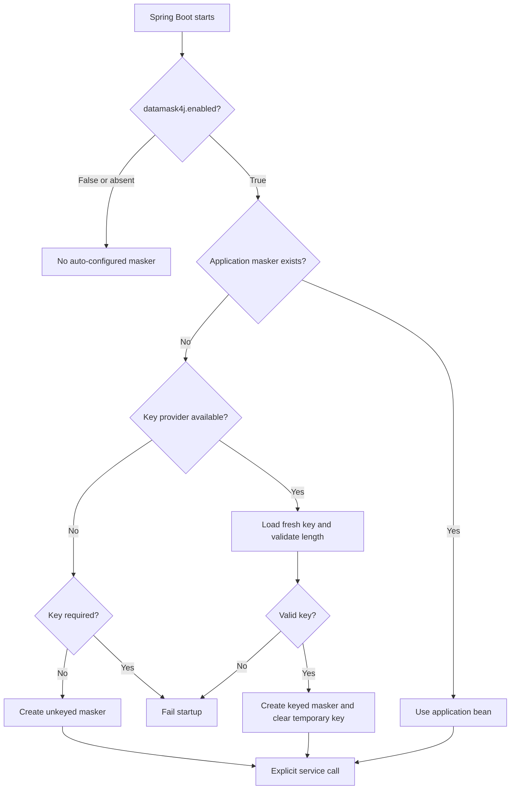

For unkeyed REDACT, KEEP, CONSTANT and NULLIFY operations only, use `enabled: true` and `key-required: false`, with no provider bean. If a provider exists, its key is still validated and used. Missing required, invalid or ambiguous providers fail bean creation; provider invocation errors are sanitized without retaining their cause. Provider bean initialization outside this method is trusted application code. Spring can log its own configuration errors; do not put keys in configuration properties, exception text or logs. No key rotation, secret-manager client, automatic lifecycle erasure, actuator endpoint or database integration is supplied.

## Spring Batch data masking: explicit ItemProcessor adapters

The optional `datamask4j-spring-batch` module targets Spring Batch 6.0.6 (Java 21, aligned with the Spring Boot 4.0.9 baseline). It provides two stateless processors for explicit use in chunk-oriented steps, without starting jobs or configuring repositories, readers, writers or transactions.

```xml
<dependency>
    <groupId>io.github.hador</groupId>
    <artifactId>datamask4j-spring-batch</artifactId>
    <version>0.1.0-SNAPSHOT</version>
</dependency>
```

```java
import io.github.hador.datamask4j.batch.RecordMaskingItemProcessor;
import io.github.hador.datamask4j.annotations.RecordMasker;
import org.springframework.batch.core.repository.JobRepository;
import org.springframework.batch.core.step.Step;
import org.springframework.batch.core.step.builder.StepBuilder;
import org.springframework.batch.infrastructure.item.ItemReader;
import org.springframework.batch.infrastructure.item.ItemWriter;
import org.springframework.transaction.PlatformTransactionManager;
import org.springframework.context.annotation.Bean;

// Customer is the fully annotated public record from the preceding example.
// Supply a trusted reader, isolated transactional writer and transaction manager.
@Bean
Step maskCustomers(JobRepository repository,
                   PlatformTransactionManager transactionManager,
                   ItemReader<Customer> reader,
                   ItemWriter<Customer> writer,
                   RecordMasker masker) {
    return new StepBuilder("maskCustomers", repository)
        .<Customer, Customer>chunk(100)
        .transactionManager(transactionManager)
        .reader(reader)
        .processor(new RecordMaskingItemProcessor<Customer>(masker))
        .writer(writer)
        .build();
}
```

For string maps, instantiate `new MapMaskingItemProcessor(new DataMasker(policy))` and configure a Map<String,String> reader and writer. Both processors throw a generic BatchMaskingException on transformation failure; they never return the original input as fallback or use null to filter an item. Dropping all map fields emits an empty map, not a skipped item.

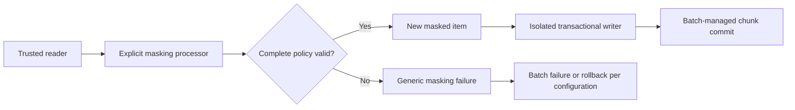

Only the application owns transaction boundaries. No skip, retry or restart policy is registered by the module. A failed chunk must not be allowed to bypass masking; do not configure a fallback writer for original items. For deterministic reprocessing use the same reviewed policy, key and scope across retries and restarts; never reprocess already masked items as raw source. Custom strategies, record constructors and accessors must be pure and thread-safe when used concurrently. Readers, listeners, execution contexts, job parameters, writers and tracing are outside the masking boundary and must not retain or log raw data. A transactional writer and appropriate job repository are required for actual rollback and restart guarantees. Processor and JDBC job rollback/restart tests passed CI.

### Spring Batch transaction and restart integration tests

The integration tests use a Spring Batch JDBC JobRepository, an isolated embedded H2 database and a transactional JDBC writer. Four synthetic customer records are processed in chunks of two. One scenario deliberately fails after a row is inserted in the second chunk. It checks that the failed chunk leaves no rows, the first chunk remains committed, and restart resumes at the saved reader position with the same HMAC key and policy. A separate successful-job scenario compares every output row to its expected masked value.

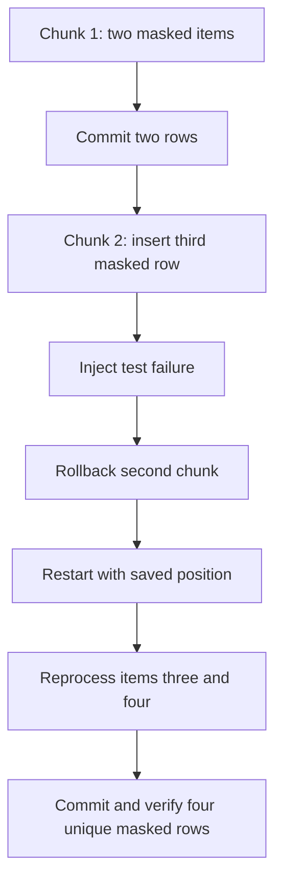

Run with `mvn -B -ntp -pl datamask4j-spring-batch -am clean verify`. The tests use synthetic fixtures only, no external database or credentials. This is evidence for the specific synchronous JDBC job, reader and transaction manager configuration after CI validation; it does not guarantee restart safety for arbitrary readers, partitioning, distributed jobs, nontransactional destinations or key changes. Earlier committed chunks are not rolled back when a later chunk fails. Publish the complete dataset only after a successful job and review.

## Offline data masking CLI

The optional standalone CLI masks UTF-8 CSV or flat JSON using a reviewed YAML field policy. No Spring or database is required. Build locally:

```bash
mvn -B -ntp -pl datamask4j-cli -am clean verify
mkdir -m 700 masked
java -jar datamask4j-cli/target/datamask4j-cli-0.1.0-SNAPSHOT-standalone.jar \
  mask --format csv --input customers.csv \
  --output masked/customers.csv --policy policy.yml
```

For HMAC policies, add `--key-file /path/to/private-key` pointing to an existing owner-only file of exactly 32 raw cryptographically random bytes. Never pass the key value on the command line or store it in the policy. All file paths and their parent directories must be trusted, stable local paths. The output directory must already exist with POSIX mode 0700 and support hard links; output files have mode 0600. Platforms without these features fail closed. The CLI rejects final-component symlinks for inputs, policy, key and output directory, and rejects existing output (including dangling symlinks and hard links). It never overwrites input or existing destination.

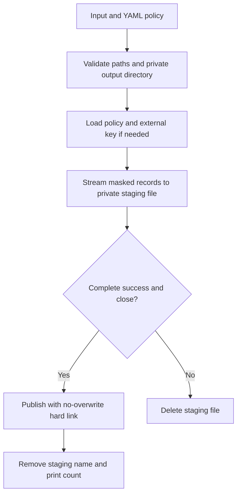

Exit codes: 0 success/help, 1 processing failure, 2 invalid arguments. Output contains counts only, and errors omit filenames, values and causes. If staging cleanup fails, a generic warning is printed; inspect the private directory. A crash can leave a staging file. This is atomic name publication, not fsync/power-loss durability or protection against a malicious concurrent directory owner. Do not use shared or untrusted paths, and review all KEEP rules before exporting. No database CLI, YAML faker adapters, recursive discovery or overwrite mode in this milestone.

## Architecture

```text
DataMask4j
├── datamask4j-core       # policy, field rules, masking engine
├── datamask4j-crypto     # scoped HMAC pseudonymisation
├── datamask4j-faker      # deterministic European fixture substitutions
├── datamask4j-annotations # immutable-copy masking for public Java records
├── datamask4j-spring-boot-starter # opt-in RecordMasker auto-configuration
├── datamask4j-spring-batch # explicit map and record item processors
├── datamask4j-cli # offline CSV/JSON command-line masking
├── datamask4j-file       # CSV, JSON and YAML policies
├── datamask4j-jdbc       # PostgreSQL read-only preview
├── docs/                # threat model and roadmap
└── .github/workflows/   # build and tests
```

Core does not depend on crypto, Spring or database drivers. Optional modules will depend inward on the core contracts rather than introduce framework dependencies into every consumer.

## Security and operating limits

The engine is an in-process trusted API, not a sandbox. It handles string maps and optional bounded CSV/flat JSON adapters; it does not discover personal data automatically. Inputs must already be authorised for processing. Do not use unreviewed policies on production exports.

- Run in an isolated environment with least privilege. Never give test systems access to production databases or keys.
- Avoid logging input/output records, exposing them in error reports, or including them in CI artifacts. Use synthetic test fixtures.
- Treat retained values, stable pseudonyms and sensitive combinations of attributes as potentially personal data.
- The engine throws before returning on invalid schema or failed transformation. This is not a transactional rollback of custom strategy side effects.
- Review allowed output fields and downstream destinations. Masking can break application validation, column lengths or uniqueness.
- Atomic file publication, automatic relational planning, tenant isolation, key lifecycle and reidentification tests are separate milestones.

See [threat model](docs/threat-model.md) and [security policy](SECURITY.md).

## Roadmap

| Milestone | Scope | Acceptance gate |
| --- | --- | --- |
| M1 — Core | explicit field policies, HMAC, unit tests | compile, deterministic tests, schema failures |
| M2 — Structured formats | streaming CSV, JSON, YAML policies | no unclassified fields leaked; resource bounds |
| M3 — Relational export | JDBC metadata, separate source/target, FK/PK consistency, dry-run | PostgreSQL integration, read-only credentials, rollback |
| M4 — Java integration | annotations, Spring Boot starter, Spring Batch adapters | standalone consumer tests, compatible versions |
| M5 — Operational features | reports without raw data, scoped key lifecycle, fake data adapters | threat model review, misuse tests, performance |
| M6 — Release | SBOM, dependency and secret scans, signatures, documentation | independently reviewed 0.1.0 release candidate |

Potential future features: safe database subsetting, EU locale-specific synthetic fixtures, detection assistance and risk assessment. No automatic publication or production compliance claim.

## PostgreSQL integration testing

The PostgreSQL test profile starts an isolated disposable database using Testcontainers. It creates synthetic records and dedicated SELECT-only and write-capable roles, never connects to production, and requires a working Docker daemon.

```bash
mvn -B -ntp -Ppostgres-integration clean verify
```

The default `mvn clean verify` runs unit tests without Docker; CI explicitly enables the integration profile and fails if no integration tests run. The suite checks actual PostgreSQL privilege enforcement, read-only transaction behaviour, correct database identity, unsupported tables/types, input bounds and unchanged source data.

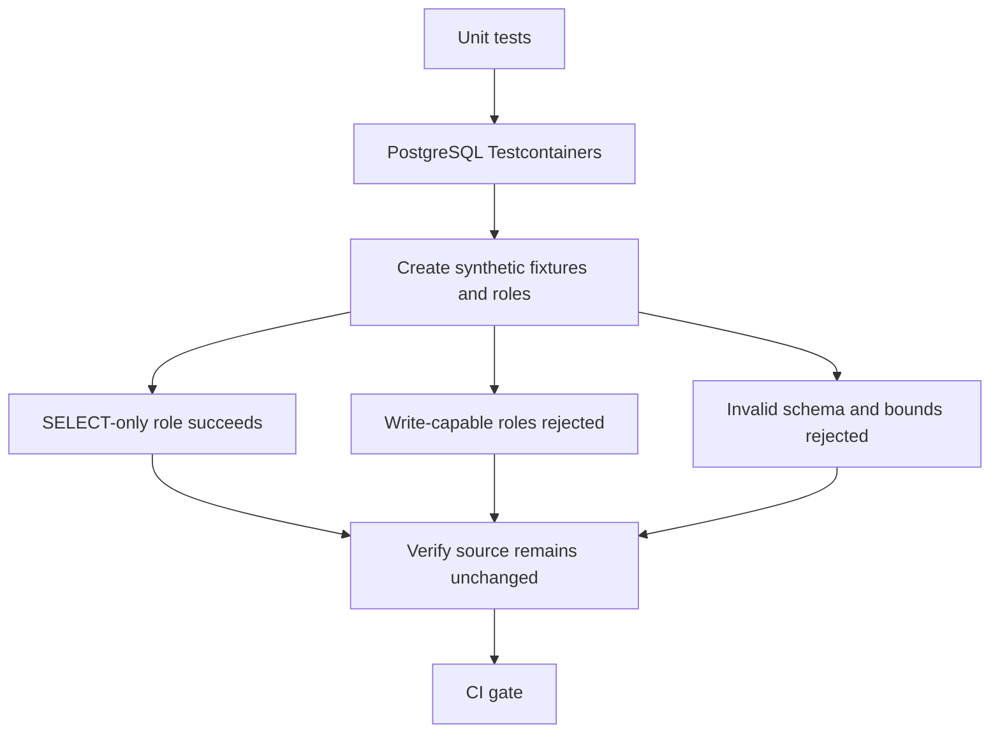

A passing integration suite is evidence for the tested cases only, not proof of production safety. The image is pinned by digest; full image and dependency vulnerability audits are still required before release.

## Testing and contributing

Run `mvn -B -ntp clean verify`. Test names use English camelCase and JUnit Jupiter. Prefer small tests of observable behaviour and known cryptographic vectors; use Mockito annotations when mocking is actually needed. Add negative cases for schema mismatches, unsafe input, key/scope boundaries and no accidental disclosure. New dependencies and security-sensitive algorithms require review.

See [roadmap](docs/roadmap.md). Report suspected vulnerabilities privately according to [SECURITY.md](SECURITY.md); never include raw personal records or credentials in GitHub issues.

## License

DataMask4j is licensed under Apache-2.0. See [LICENSE](LICENSE). The first release must undergo owner and third-party licensing review.

## Frequently asked questions

### How can I mask sensitive data in Java?

Define a strict field policy with DataMask4j Core, choose KEEP, DROP, REDACT, constant replacement or a trusted custom strategy, and call DataMasker.mask on a string map. The original record remains unchanged.

### How can I pseudonymise customer IDs consistently?

Use DataMask4j Crypto with a secret key and an explicit shared identity scope. Equal IDs produce equal versioned HMAC tokens in that scope; different scopes produce unrelated tokens. This supports controlled test-data linkage, not automatic database referential integrity.

### Is this a GDPR anonymisation library?

It provides masking and pseudonymisation primitives. It does not certify GDPR compliance or anonymisation. Pseudonymised data may still be personal data.

### Does it support Spring Boot, Spring Batch, PostgreSQL or database masking?

Partially. The snapshot has a standalone Java engine, CSV/JSON adapters with YAML policies and an opt-in Spring Boot starter in development. PostgreSQL read-only preview has passed real integration tests; single-table export has passed integration CI; ordered multi-table export is experimental. Spring Batch 6 explicit processors are experimental; automatic relational planning and full job restart testing remain roadmap items. Spring Boot compatibility beyond the initial baseline is unverified. The core has no framework dependency.

### Is DataMask4j available on Maven Central?

Not yet. Build the snapshot locally. The requested group ID is `io.github.hador`; a public release requires verified namespace ownership and release approval.

## Project status

DataMask4j is an independent open-source project by the maintainer of [BatchRecover](https://github.com/hamzador/BatchRecover). It is not affiliated with Spring, the CNIL or an EU institution.
